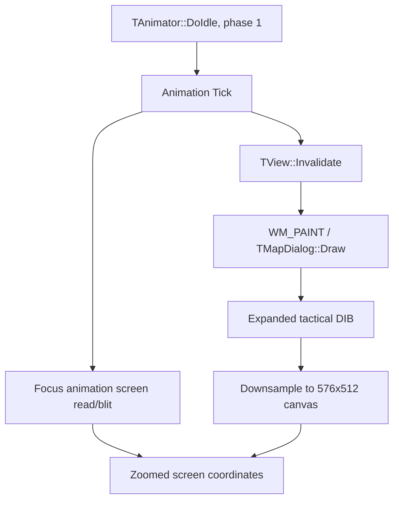

# Zoomed world-map animation investigation

Applies to the retail/GOG 1.03 executable used by this repository, on branch `Main-World-high-res`. Investigation date: November 11, 2026 (America/Denver).

**November 12 update:** [Map coordinate contract](MapCoordinateContract.md) supersedes the coordinate assumptions and verification boundary in the earlier investigation. Start Daerfentol was subsequently loaded: native frames and ticks continued with the mouse still, while an unscaled explorer/background patch appeared at 0.75x. Direct blits outside both Tick and DrawSelection scopes remain uncovered. Static tracing also established that native Draw and ScreenToTile use map-local coordinates; `(10,58)` is the canvas placement and must not be added to the expanded Draw rectangle or subtracted again in the tile hook. The current source corrects those two errors, but a live comparison of that build remains pending.

## Result and verification boundary

The bridge contained several independently reproducible rendering bugs. Animation invalidations and direct screen blits used the original map coordinates after the map had been downsampled. Selection restores transposed rectangle axes, rejected partially visible tiles, and sampled patches differently from full frames. A supposed sprite-transparency workaround also misidentified the terrain cache as an animation strip.

The code corrects several covered paths, with headless tests exercising the production hooks, real GDI blits, and DIB pixels. This is **not an end-to-end confirmation that every in-game animation works**. Later live evidence showed that frames and ticks advanced with the mouse still in Start Daerfentol. The observed failure is in presentation; other animation classes remain unverified.

Validation results: 68 map-animation/input checks, 218 map-coordinate checks, and 133 existing graphics checks passed. The new coordinate suite separately reports three known source-offset animation discrepancies; they are unresolved findings, not animation passes. The read-only binary inspectors passed against both the repository executable and working game executable. The earlier multiplayer suite passed its export/address checks, then failed at `Blank-IP scan across all interfaces found Host`; an isolated run using the previous committed DLL failed at the same assertion. The remaining network stages were not reached, and no networking changes were made.

## Follow-up: explorer position and terrain interaction

The user reported that the explorer appeared detached from terrain, occasionally blinked, and could not interact with the visible map after zooming out. The earlier tick-only changes did not cover every path. Three additional problems were identified:

- Both mouse-message routing and `ScreenToClient` expanded map points before native UI hit-testing. At 0.5x a visible point such as `(522,442)` became `(1034,826)` while the game was still choosing a pane on an 800x600 canvas. Zoom-out input now remains in canvas coordinates through pane routing and is expanded only by `MyMapScreenToTileHook`, using the last full-map buffer origin and scale. The hook passes a temporary point, preserving the caller's original point for later UI handling.
- `DrawSelection` synchronously restores/draws the focus animation outside Tick. It now establishes the same map-animation scope, with `finally` cleanup. Previously those blits could stamp the explorer at its original unzoomed position even after the tick path was corrected.
- Panning calls `TAnimator::UpdateAniLocs` with a hard-coded retention rectangle `(-64,-64)-(640,576)`. That routine frees animations outside the rectangle, even when they lie inside the expanded visible map. The map-specific call now expands the right/bottom bounds to `ceil(576/zoom)+64` and `ceil(512/zoom)+64`, preserving native camera deltas and the original 1x behavior. The call signature is validated before patching, and the instruction cache is flushed afterward.

The 68-check suite includes production mouse-message routing at 4K, polled cursor coordinates, deferred tile conversion beyond the original canvas, a projected explorer anchor mapping back to its original native terrain point at 0.5x/0.25x, synchronous selection scope, and expanded animation retention bounds. These are controlled headless fixtures. The fixture now models native pane localization before invoking ScreenToTile. Start Daerfentol was subsequently loaded from the patched game directory; it exposed independent redraws outside the covered scopes. See the newer report for the trace, exact local-coordinate contract, and remaining live acceptance checks.

## Confirmed defects and changes

| Path | Previous behavior | Change |
| --- | --- | --- |
| Animation invalidation | Map coordinates were clamped to 800x600 before zoom. A unit at X=1002 produced an empty rectangle at X=800. | Scope native animation ticks to the active map view, map invalidations to the zoomed canvas, then scale to the display. |
| Direct focus-animation blits | Destination and saved-background reads used display scaling without map zoom. | Apply map zoom to both screen writes and screen reads during map animation ticks; preserve native ROPs and clip to the map. |
| Selection `CopyBits` | Interpreted `tagRECT` as top/left/bottom/right, unlike the full-map path. | Use left/top/right/bottom. |
| Partially visible selection restores | Required the entire projected tile to lie inside the viewport. | Intersect the dirty footprint with the viewport, keeping the global sampling grid. |
| Patch filtering | Always nearest-neighbor; each patch had its own rounded size and origin. | Use the full-map Nearest/Smooth/Sharp sampler and its exact source origin/scale, restricted to dirty output pixels. |
| Terrain-cache presentation | Treated any wide, short bitmap as a transparent sprite strip; guessed transparency from its corner. | Remove that heuristic. A native 7040x64 bitmap is the 110-slot terrain cache. Native QuickDraw handles sprite composition/masks. |
| CPU reads of GDI-written DIBs | Read pixels without flushing pending native GDI work. | Call `GdiFlush` before sampling. |

The wrong coordinate space explains why mouse movement can appear to advance animation: hovering, selection changes, scrolling, and other input may trigger a larger paint that happens to display the latest native frame. Later hands-off runtime logs recorded advancing native frame counters and ticks while the visible explorer still suffered incorrect redraws. This supports a presentation failure in the observed scene.

The supplied screenshot's checkerboard/background damage is consistent with the faulty cache presentation and restore paths. It is not proof that all corruption has the same cause; cache-slot reuse remains a separate concern.

## Native rendering paths



Two transformations must agree:

1. Expanded tactical buffer -> the map's canvas rectangle `(10,58)-(586,570)`.
2. Virtual 800x600 canvas -> the physical presentation, including `DstX/DstY` pillarboxes.

Full draws use source extents `ceil(576/zoom)` by `ceil(512/zoom)`. At 0.75x the height is 683, so multiplying both axes by exactly 0.75 is not identical to the full-map sampler. Dirty updates use `s_lastSx0/s_lastSy0/s_lastScaleX/s_lastScaleY` from the last full map copy. The animation rectangle helper still derives geometry independently: although it uses the rounded extent dimensions, it does not include arbitrary sampled source offsets. Three diagnostics demonstrate this disagreement. Rendering and input must share the recorded transform described in the newer report.

`MyAnimationTickHook` calls the original native tick. It does not create an animation clock, synthesize mouse movement, or periodically redraw the whole screen. Its thread-local scope applies only when `[animation+4]` equals the current `TMapDialog` pointer, and is restored in `finally`. Full map drawing and unrelated dialogs retain their rendering paths. Direct blit interception is limited to small frames so a reentrant full-window paint is not mistaken for a sprite.

## Verified native addresses

These are **virtual addresses in the current executable**, not file offsets. The bundled `Imperialism II.map` comes from a different link. For example, it lists `CopyBits` at `0x004A7490`, while the executable's `0x00404E8F` jump resolves to `0x004AAA40`. Use the map for names and relationships; verify every address against the actual binary.

| Class | Vtable | Tick slot (`+0x28`) | Original thunk | Tick implementation |
| --- | --- | --- | --- | --- |
| TAnimation | `0x006F6D90` | `0x006F6DB8` | `0x004041F6` | `0x004B7DE0` |
| TCivAnimation | `0x006F6DE8` | `0x006F6E10` | `0x00408E40` | `0x004B8250` |
| TOneTimeAnimation | `0x006F6E30` | `0x006F6E58` | `0x004063E8` | `0x004B8460` |
| TFocusAnimation | `0x006F6E78` | `0x006F6EA0` | `0x00402608` | `0x004B8690` |
| TTransFocusAnimation | `0x006F6EC8` | `0x006F6EF0` | `0x00402608` | `0x004B8690` |
| TScriptedAnimation | `0x006F6F20` | `0x006F6F48` | `0x00408922` | `0x004B9090` |

The hook installer checks all six original slot values before changing any animation slot. This check covers the new animation hooks; it is not comprehensive validation of the bridge's older runtime patches.

| Address | Verified behavior / debugging use |
| --- | --- |
| `0x004B9C40` | `TAnimator::DoIdle`: runs animation iteration for phase argument 1. |
| `0x004B9CCE` / `0x004B9CD2` | Fetch animation vtable, then call virtual Tick at `+0x28`. Good scheduler breakpoint. |
| `0x0055AB36` -> `0x0040104B` -> `0x004B9EC0` | Map camera change calls `TAnimator::UpdateAniLocs`. Arguments are two 32-bit camera deltas and a 16-byte rectangle by value; callee pops 24 bytes. |
| `0x00703AC4`, `0x00703D54`, `0x00703FE4` -> `0x004078C9` -> `0x0055A5A0` | Map ScreenToTile slots/thunk/implementation. Input point is two 32-bit coordinates by reference, followed by three output pointers; callee pops 16 bytes. |
| `0x004B7DFC`, `0x004B8285`, `0x004B84A0` | Base, civilization, and one-time Tick calls to `TView::Invalidate`. |
| `0x00408A49` -> `0x0049FBF0` | `TView::Invalidate` thunk/implementation. Converts view-local rectangle through virtual `+0x134`, then invokes Win32 `InvalidateRect`. |
| `0x0076C5CC` | Imported Win32 `InvalidateRect`, already intercepted by the bridge. |
| `0x004B86E0` | Focus animation idle draw; calls virtual DrawNextFrame. |
| `0x004B8C10`, `0x004B8CB0` | Transparent-focus idle draw / DrawNextFrame implementation. Saved-background restore and masked-frame composition occur here. |
| `0x00409ADE` -> `0x0055D070` | `TMapDialog::Draw` thunk/implementation, hooked through vtable slot 69. |
| `0x0055D57E` onward | Looks up a tile animation; DrawNextFrame is called at `0x0055D60A` with `(64,64)` tactical-buffer offset. |
| `0x0055D889` | Full map `CopyBits` call. Source rectangle gets the tactical-buffer offset before copying. |
| `0x00559BC2`, `0x00559CA5`, `0x0055B35E`, `0x0055B442` | Old/New World selection restore copies. |
| `0x00404E8F` -> `0x004AAA40` | Windows QuickDraw `CopyBits`, using 32-bit `tagRECT` L/T/R/B. |
| `0x00559932` | Immediate value 7040 in the terrain-cache allocation; proves `110 * 64` width. |

Relevant native animation layout, recovered from constructor/tick instructions:

| Offset | Meaning |
| --- | --- |
| `+0x00` | Vtable pointer |
| `+0x04` | Owning view pointer |
| `+0x08` | Current frame, 16-bit |
| `+0x0A`, `+0x0C` | Frame count / frame-resource fields (class dependent) |
| `+0x10`, `+0x14` | Tick accumulator and threshold |
| `+0x18` | Animation identifier |
| `+0x1C` | Four 32-bit rectangle coordinates |

Do not read an animation object after a potentially self-deleting Tick. Diagnostic frame-change counts inspect only the verified base/civilization/focus/trans-focus implementations. Scripted and one-time ticks are counted without post-call dereferences.

For the supported DIB path: `PixMap+0x1C` points to the DIB object; `DIB+0x0C` is pixels and `DIB+0x10` is BITMAPINFO. Signed height determines scanline orientation, rows are DWORD aligned, and the CPU sampler supports 16-bit RGB555/RGB565.

## Repeatable inspection and automated checks

Run the read-only binary check before changing addresses:

```powershell
.\src\InspectMapAnimation.ps1
.\src\InspectMapAnimation.ps1 -Exe '.\Imperialism II - Patched\Imperialism II.exe'
```

It parses PE sections, prints the executable hash, validates the six Tick slots and jump targets, verifies animation invalidation and map CopyBits call sites, and checks the terrain-cache allocation. It needs no Python, disassembler, SDK, or process access. Investigation used Capstone disassembly to follow instructions; the script preserves the relevant binary checks without that dependency.

Build normally, then compile/run the headless checks from the repository root:

```powershell
powershell -ExecutionPolicy Bypass -File .\build.ps1
$csc = 'C:\Windows\Microsoft.NET\Framework\v4.0.30319\csc.exe'
& $csc /nologo /platform:x86 /r:obj\Imp2Net.dll /out:obj\TestMapAnimation.exe .\tests\TestMapAnimation.cs
.\obj\TestMapAnimation.exe
& $csc /nologo /platform:x86 /unsafe /r:obj\Imp2Net.dll /out:obj\TestGraphicsBridge.exe .\tests\TestGraphicsBridge.cs
.\obj\TestGraphicsBridge.exe
```

`build.ps1` regenerates `dplayx.ini` with defaults; preserve customized configuration before using that script. This investigation's deployment builds the managed assembly and standalone DLL directly, preserving the working game's configuration.

New checks exercise production behavior rather than repeating formulas: controlled tick-callback fixtures through the real hook, out-of-canvas invalidations, non-map isolation, exception-scope cleanup, full-vs-dirty pixel equality for all filters, RGB555/RGB565 and both scanline orientations, fractional scale, asymmetric coordinates, partially visible tiles, and actual GDI opaque blits/clipping. The test callback stands in for native Tick; the game scheduler and reverse-P/Invoke dispatch are not exercised headlessly. Native timing and actual view ownership still require gameplay validation.

## Runtime troubleshooting

Set this in the game's `dplayx.ini`, then restart:

```ini
[Graphics]
AnimationLog=1
```

Look for `Animation Tick hooks installed (6 classes)` in `graphics.log`, first binding records with vtable/view/map pointers, and approximately one-second cumulative summaries:

```text
Animation: zoom=0.5 frameBefore=... ticks=... mapTicks=... frameChanges=... invalidations=... directBlits=... selectionPatches=...
```

These summaries are emitted by ticks, not an independent timer. No summaries can mean no ticks, a wrong DLL/configuration, or failed hook installation. Check startup/binding records before drawing a conclusion. Binding records capture the first eight ticks at each zoom-out level, including animations that do not match the active map. Counts are cumulative; compare deltas between successive lines. `frameChanges` covers only the safe classes listed above; zero can also mean a scripted frame delay or disabled animation.

| Observation | Next investigation |
| --- | --- |
| No installation message / signature mismatch | Confirm the loaded DLL, executable hash and variant. Do not force unknown addresses. |
| `ticks` advances, `mapTicks` does not | Compare binding view/map pointers. Verify whether this variant owns animations in a child view, and map that relationship explicitly. |
| Tick counters only move with input | Investigate original MFC/application idle scheduling, focus/activation, modal loops, and animation settings. Break at `0x004B9C40`; compare phase and tick threshold. Rendering-only fixes cannot repair a stopped clock. |
| `mapTicks` advances, `frameChanges` stays flat | Inspect `+0x10/+0x14`, script delays, frame/resource fields, and animation settings. Include one-time/scripted limitations in interpreting the counter. |
| Frames change, mapped invalidations increase, image freezes | Break at `MyMapDialogDrawHook`, native map Draw, and map CopyBits; inspect Win32 update regions and physical clip regions. |
| Only selected unit freezes | Follow focus/trans-focus idle draw, screen-background reads, masked composition, and direct screen blits. |
| Full redraw looks right, selection corrupts it | Check selection source rectangle, last full-map source origin/scale, DIB orientation/masks, and cache slot identity. |
| Wrong terrain appears after panning at 0.25x | Investigate round-robin tile-cache eviction; do not assume stale cache indices still identify their original tile. |

For a useful report, retain executable/DLL hashes, exact game/DLL folder, graphics configuration, resolution/DPI and Fit/Stretch setting, zoom/filter, Old/New World, selected unit type, and a 10-second hands-off log followed by a mouse-movement log from the same scene. Avoid changing turns or selection between those two samples.

## Gameplay acceptance matrix still to run

Load the first saved game named `start`. At 1x, record the explorer's tile and neighboring terrain. Zoom to 0.75x, 0.5x and 0.25x without issuing movement orders. Confirm that the explorer stays on that tile, clicking its displayed position selects it, and terrain hover/actions refer to the tile under the pointer. Reset zoom and confirm the same tile again. Do not overwrite the save during this comparison.

Also compare an explorer/worker/ship, both selected and unselected. At each zoom, leave the pointer still for at least ten seconds, then move it. Check units near every viewport edge and beyond the original right/bottom extent; scroll/pan, switch Old/New World, open/close a modal, reset zoom, and repeat in fullscreen/windowed modes. Check that the sidebar preview remains its normal size, terrain behind moving frames is restored, and no marks remain after selection changes. Verify at native 800x600 and a high-resolution Fit display; include Stretch if used.

## Further improvements

- Replace round-robin cache reuse with coherent tile-to-slot ownership/eviction. Expanded views exceed 110 slots; bounding the allocator prevents memory overwrite but does not prove that all old tile records remain valid.
- Audit native `SelectClipRgn`/`ExtSelectClipRgn` region transforms, which still use legacy bridge behavior. Rectangle clip hooks are zoom-aware during map ticks; arbitrary region handles need a separate coordinate-space audit.
- Apply validation and atomic installation to every older engine patch; check allocation/protection results and flush the instruction cache after writing executable stubs.
- Rate-limit or buffer the existing per-blit `File.AppendAllText` logging. Thousands of synchronous writes on the UI thread can perturb idle cadence and invalidate performance measurements.
- Preserve user configuration in `build.ps1` and expose an explicit diagnostic toggle. The new AnimationLog output is already off by default.
- Manage cached DC/bitmap lifetimes explicitly across window destruction, new games, and display changes; confirm DIB pixel masks and palette conversions when adding other formats.
- Preserve/restore caller GDI clip state in label rendering. Label drawing currently changes clipping and should be audited before unifying all overlays into one compositor.
- Measure native ticks, paint count, draw time, and presented frames separately before adding a timer. If a wakeup is required, use a bounded UI-thread mechanism that respects modal/activation state and native speed, rather than redrawing the expanded map on every mouse move or from a worker thread.
